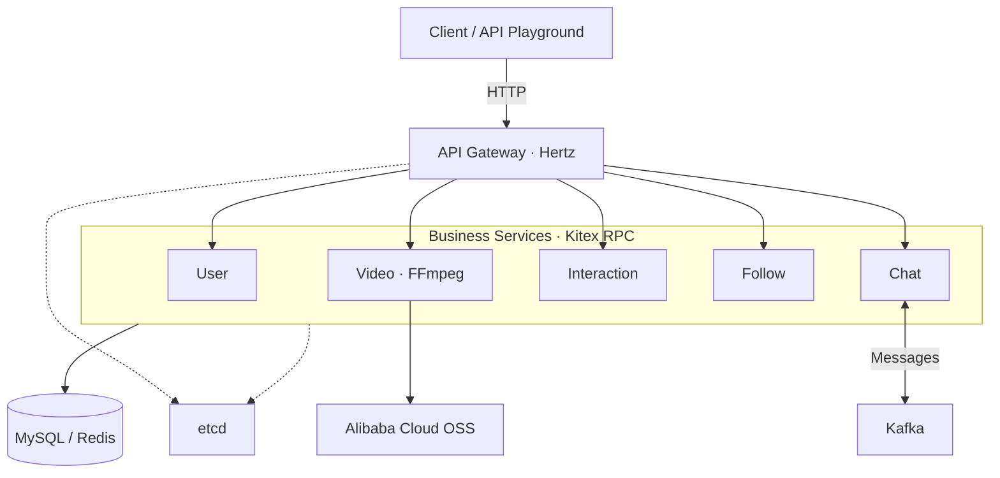

# TikTok Microservices Demo

**English** | [中文](docs/zh-CN/README.md)

A Go microservices backend for a short-video social app with video feeds, social interactions, and direct messaging.

## Features

- **Service coordination:** etcd-based service discovery and centralized configuration.
- **Caching:** Redis caches for video feeds and follow relationships.
- **Asynchronous messaging:** Kafka-based chat persistence with synchronous fallback.
- **Video publishing:** OSS storage with custom covers or FFmpeg-generated thumbnails.

## Technology Stack

| Area | Technologies |
| --- | --- |
| Language | Go |
| HTTP & RPC | Hertz, Kitex, Thrift, Protocol Buffers |
| Data | MySQL, GORM, Redis |
| Messaging & Configuration | Kafka, ZooKeeper, etcd |
| Media | Alibaba Cloud OSS, FFmpeg |
| Deployment | Docker, Docker Compose, Nginx |

## Architecture

The HTTP gateway calls five business services through Kitex RPC. etcd provides service discovery and shared configuration.

[Startup guide](start_steps.md) · [API reference](demo/tiktok.openapi.json)
