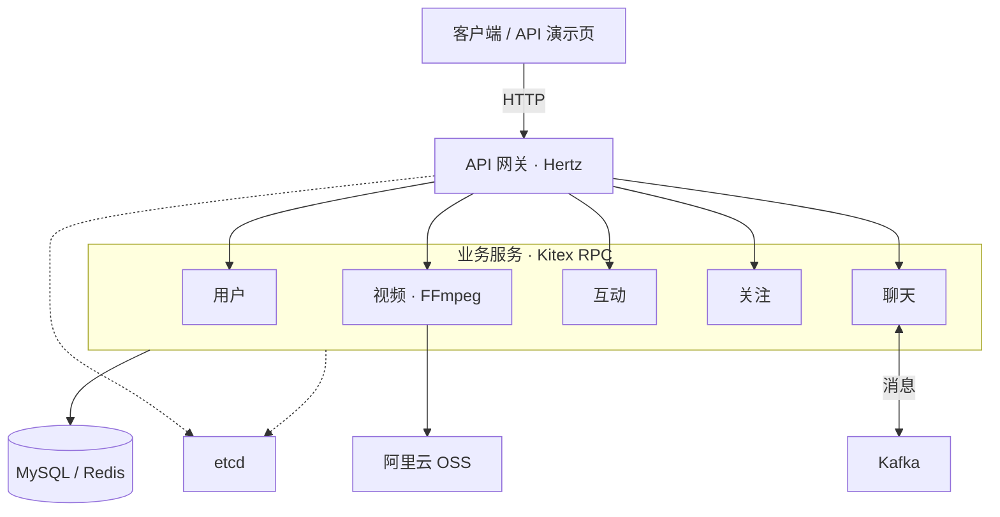

# TikTok Microservices Demo

[English](../../README.md) | **中文**

一个基于 Go 微服务架构的短视频社交应用后端，支持视频流、社交互动和私信聊天。

## 项目特色

- **服务协同：** 基于 etcd 实现服务发现与集中配置。
- **缓存机制：** 使用 Redis 缓存视频流和关注关系。
- **异步消息：** 通过 Kafka 持久化聊天消息，并支持同步写入回退。
- **视频发布：** 使用 OSS 存储视频，支持自定义封面或 FFmpeg 自动生成封面。

## 技术栈

| 领域 | 技术 |
| --- | --- |
| 编程语言 | Go |
| HTTP 与 RPC | Hertz、Kitex、Thrift、Protocol Buffers |
| 数据存储 | MySQL、GORM、Redis |
| 消息与配置 | Kafka、ZooKeeper、etcd |
| 媒体处理 | 阿里云 OSS、FFmpeg |
| 部署 | Docker、Docker Compose、Nginx |

## 项目架构

HTTP 网关通过 Kitex RPC 调用五个业务服务，etcd 提供服务发现与共享配置。

[启动指南](start_steps.md) · [API 文档](tiktok.openapi.json)
